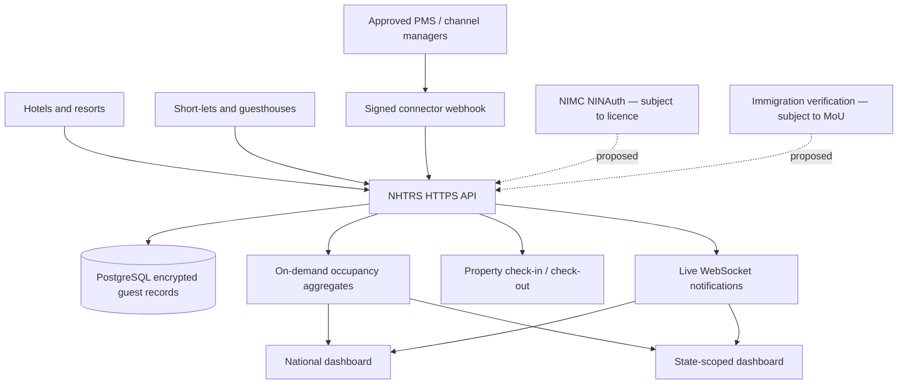

# NHTRS — National Hospitality, Tourism & Accommodation Registration System

**Newsoft PLC | GitHub-ready deployable technical pilot v0.2 | 21 November 2026**

NHTRS registers participating Nigerian accommodation providers, manages actual guest check-ins and check-outs, aggregates occupancy by state and property type, and updates authorised dashboards through WebSockets. It is a **working software pilot**, not a connected or legally approved national government system.

**GitHub, Codex and VPS deployment:** See [`docs/DEPLOY.md`](docs/DEPLOY.md), [`AGENTS.md`](AGENTS.md) and the GitHub Actions workflows under `.github/workflows/`. To run the HTTPS overlay use `docker compose -f compose.yaml -f compose.prod.yaml up -d --build --wait` after setting `NHTRS_DOMAIN`. These workflows are prepared but have **not** been run on GitHub or a public VPS.

## Included implementation

| Component | Implementation |
|---|---|
| Frontend | Responsive HTML/CSS/vanilla JavaScript dashboard, no external CDN |
| Backend | FastAPI, OpenAPI at `/api/docs` |
| Database | PostgreSQL in Docker; SQLite for development/tests |
| Authentication | Argon2 password hashing, signed 8-hour HTTP-only session cookie, CSRF protection |
| Data controls | Field-level Fernet encryption of guest registration records; HMAC blind ID hashes; masked references |
| Authorisation | National aggregates/admin; state-scoped aggregates; property-scoped staff operations |
| Live updates | WebSockets sending an authorised `occupancy_changed` signal after check-in/out |
| Integration | HMAC-signed per-property PMS webhook with 5-minute timestamp window and event-ID replay detection |
| Logs | 100 latest audit events via national administrator account; database retains more |
| Tests | End-to-end integration tests using fictional guest records |

**Not connected:** NIMC/NINAuth, NIS visa/CERPAC, Airbnb, Booking.com, Expedia, third-party PMS systems, hotel registries, SMS and email services. NHTRS does not independently verify identity or immigration status.

## Quick start: local host with Docker

1. Install Python 3.12+ and Docker Compose. Install the Python dependencies required to generate secrets: `python -m pip install cryptography` (or install all requirements).
2. Run `python scripts/init_env.py` inside this folder. It creates private `.env` values and prints the first administrator password once. **Never commit `.env` to source control.**
3. Run `docker compose up --build -d` from this folder.
4. Visit **http://localhost:8000** in a browser, sign in with `admin` and the generated password.
5. Register a fictional test property and create a property-level user (use a new strong password). Sign in with that property user to register fictional Nigerian or foreign guests.
6. Return to the national account to see reported occupancy update. Check out the stay to release the unit.
7. Run `docker compose down` to stop the pilot. The PostgreSQL volume persists, so check-in data remains until you securely remove it.

The base service binds to **127.0.0.1:8000**, not the public internet. To expose it safely, put it behind a TLS-enabled reverse proxy. `Caddyfile.example` demonstrates a Caddy configuration.

For a permitted HTTPS pilot, update `.env` as follows and restart the API:

```
COOKIE_SECURE=true
ALLOWED_ORIGIN=https://nhtrs.newsoftplc.ng
```

Configure DNS and reverse proxy, then verify TLS, cookies, WebSocket proxying, firewall rules and backups before uploading non-fictional records. The pilot hostname is `nhtrs.newsoftplc.ng`.

## Main workflows

### Agency and operator roles

**National administrator:** can register properties, create user accounts, see aggregated reporting by state/FCT, property type and Nigerian/foreign guest classification, and inspect the audit log. Does not have a general guest-record search endpoint.

**State analyst:** sees aggregated reporting for assigned state/FCT and its enrolled properties. Cannot read personal records.

**Property operator:** can check in multiple guests into a specific unit, inspect masked guest-registration details, check out stays and provision/revoke a PMS integration credential. Cannot see other properties' guests or report their data.

### Nigerian citizen registration

Full name, telephone, email and an 11-digit NIN are required in this pilot. Address and occupation are supported. Identity value is encrypted, hashed for internal linkage and masked when details are displayed. **The backend does not check the NIN against NIMC.** Exception workflows for minors and people without a readily available NIN are a production requirement, not implemented here.

### Foreign-national registration

Full name, telephone, email, nationality and passport reference are required. Entry basis is recorded as `visa`, `visa_exempt`, `ecowas` or `residence_permit`. Visas require a visa reference. Residence-permit entry requires a permit reference. Separate residency status `visitor` or `resident` is recorded, with optional visa dates, passport expiry and permit fields. These are **declared records, not NIS determinations of lawful status**.

Each stay represents one occupied accommodation unit, no matter how many guests share it. Each guest is counted for the Nigerian/foreign guest totals. The dashboard counts checked-in stays until a checkout event is received; it cannot measure physical presence independently.

## PMS webhook

Property users can issue a credential from the **PMS integrations** tab. The key is shown only once. The standard signed endpoint is `POST /api/integrations/pms`. Set environment variables `NHTRS_PMS_KEY_ID` and `NHTRS_PMS_SECRET` to the issued credential, and run:

```bash
python scripts/pms_client.py
```

The example script sends a **fictional** test check-in. The headers are:

- `X-NHTRS-Key-ID`: key ID provided at provisioning
- `X-NHTRS-Timestamp`: current Unix seconds
- `X-NHTRS-Event-ID`: unique event reference
- `X-NHTRS-Signature`: HMAC-SHA256 hex digest of `timestamp.event_id.` immediately followed by the exact JSON bytes, keyed with the shared secret

A PMS check-in requires an `external_ref` and unit plus guest details. A checkout can identify a previously registered stay by `stay_id` or external reference. Retried events with the same event ID are ignored. There is no generic scrape or unauthorised extraction from Airbnb; use a host-authorised channel manager or a separately approved partner API.

## Development without Docker

```bash
python -m pip install -r requirements.txt
python scripts/init_env.py
# Export the contents of .env into the shell through an appropriate secure env loader
export DATABASE_URL=sqlite:///./nht.db
uvicorn app.main:app --reload --port 8000
```

**Tests:** `python -m pytest -q tests/test_api.py` (passage verified on the supplied package). Do not run the tests against your live national database: the tests create fictional new properties/accounts in a separate temporary SQLite database.

## Architecture and data flow



## Production-readiness gaps and required authorisations

This prototype is **not production-ready for nationwide collection of citizens' or visitors' identity information**. Before any real personal records are processed, arrange an appropriate lawfully authorised controller, processor agreement, data protection officer, privacy notice, completed data protection impact assessment (DPIA), legal basis for each data field, and agreed retention/deletion schedule; confirm NDPC registration obligations. A nationwide live guest-location directory should **not** be created by treating a local guest-register obligation as blanket government access authority. Individual guest access should require a separate legal request process, narrowly scoped, approved, time-limited and logged.

Technical production work includes: enforce MFA/SSO, managed secrets and periodic key rotation; a real user-deactivation and token-revocation mechanism; immutable append-only audit storage; database migrations; encrypted off-site backups and tested restores; a retention/deletion scheduler; rate limits and abuse controls; monitored firewalls/WAF; a queue and Redis pub/sub for live updates across multiple replicas; accessibility and mobile testing; third-party penetration tests; incident-response processes; selective disclosure and small-group count suppression; and separate secure lawful guest-record release endpoints. The pilot uses local-process WebSockets and is intended for a single API instance only. The supplied GitHub deployment workflow is strictly a manually approved staging deployment and never runs from an unreviewed pull request.

The system assumes accommodation providers are onboarded and actually report arrivals/departures. **It cannot show all Nigerian hotels or Airbnb guests until the properties or authorised providers are connected.** Coverage and reporting latency should be published as separate data-quality metrics.

**Official integration prerequisites:** NIMC/NINAuth requires an approved verification route, subject consent or other appropriate lawful basis, API credentials and terms. NIS residency and visa checks require an approved inter-agency interface and agreement. Airbnb connections should use authorised software/channel-manager partners; reservation availability is not by itself a guest's identity or check-in record. The nationwide regulatory lead must be resolved with relevant federal/state authorities before claiming licensing or enforcement powers.

## Primary legal and implementation references

- Nigeria Data Protection Act 2023 (NDPC): https://ndpc.gov.ng/wp-content/uploads/2024/03/Nigeria_Data_Protection_Act_2023.pdf
- NINAuth published information: https://ninauth.nimc.gov.ng/news-room/nigeria-ushers-new-era-secure
- Nigeria Immigration Service, CERPAC: https://immigration.gov.ng/combined-expatriate-residence-permit-and-aliens-card-cerpac/
- Airbnb's official software partners: https://www.airbnb.com/software-partners
- Legacy Immigration Regulations 1963 guest-register provisions (verify their current application and later amendments with Nigerian counsel): https://lawsofnigeria.placng.org/laws/I1.pdf

**Do not use test account details, sample identity numbers or this demo installation to record actual guests.**
